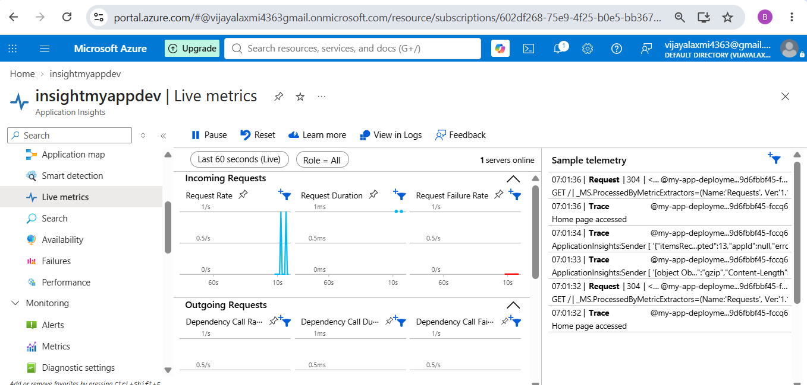
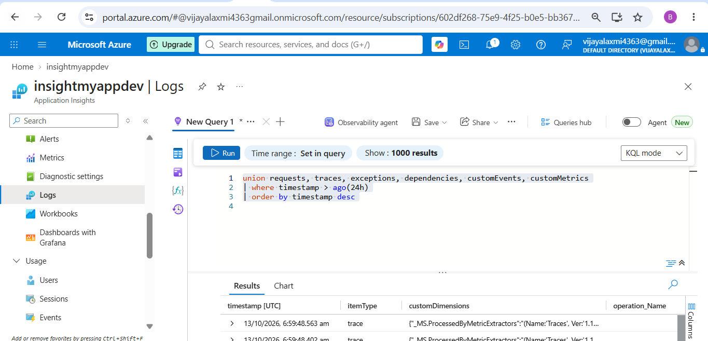
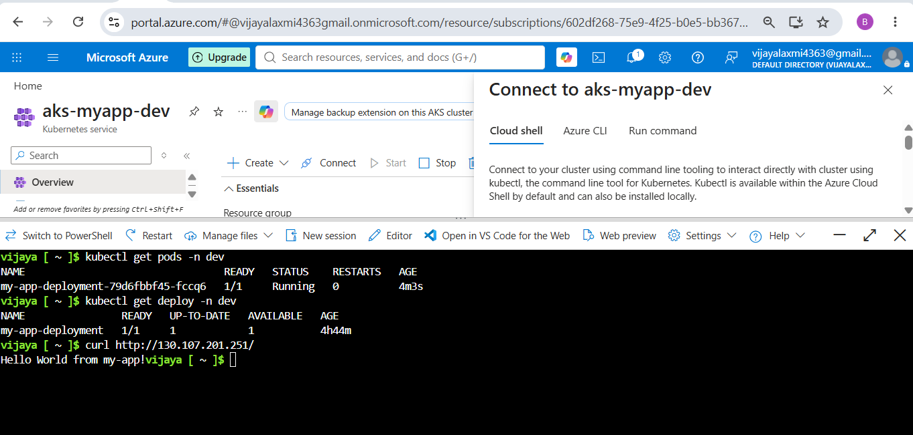

Node JS Project deployed to Kubernetes using Helm Charts to multi environment. Deployed infrastructure using Terraform. Monitoring using App insight.

App Code: \
app folder: package.json file, Dockerfile, src\server.js file. 

Terraform: \
Modules: \
RG, ACR, AKS, VNET, azure-monitor \
ACR Pull resource code. (provide user access administrator role for azure service connection) \
Environments folder: \
dev.tfvars, dev.yaml \
prod.tfvars, prod.yaml \
qa.tfvars, qa.yaml 

Helm: \
my-app folder: \
values.dev.yaml \
values.qa.yaml \
values.yaml

Remote backend: Provide storage account blob data contributor access to azure rm service connection. \

Dockerfile: to build image app->Dockerfile\

Helm folder: to deploy kubernetes objects using helm charts. \
 \
 \

Azurerm service connection- to deploy resources.

Pipeline: (Multi-stage pipeline using templates): \
templates folder: deploy-template.yaml \
Main yaml file: Pipeline/azure-pipelines.yaml file.

Environment: \
Dev, QA, Prod: \
 \ 
 \

Multi-stage Pipeline: \
 \
 

Pipeline Stage approval: \
 

Monitor: \
• Step 1: Provision Application Insights and a Log Analytics Workspace using Terraform, then output the Application Insights connection string to the pipeline as a variable. Add log analytics id to aks module. \
• Step 2: Add the initialization code to the top of your server.js file. \
• Step 3: Add the Application Insights variable placeholder to the Helm chart variables file (values.yaml) and env variable in deployment.yaml file. \
• Step 4: Inject the connection string variable into the Helm deploy task at runtime. \
  \
 

APP:

 \

